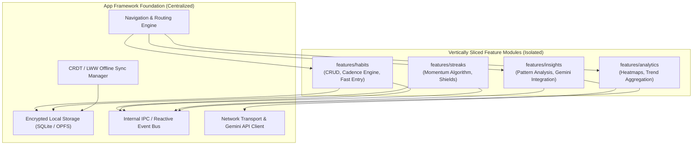
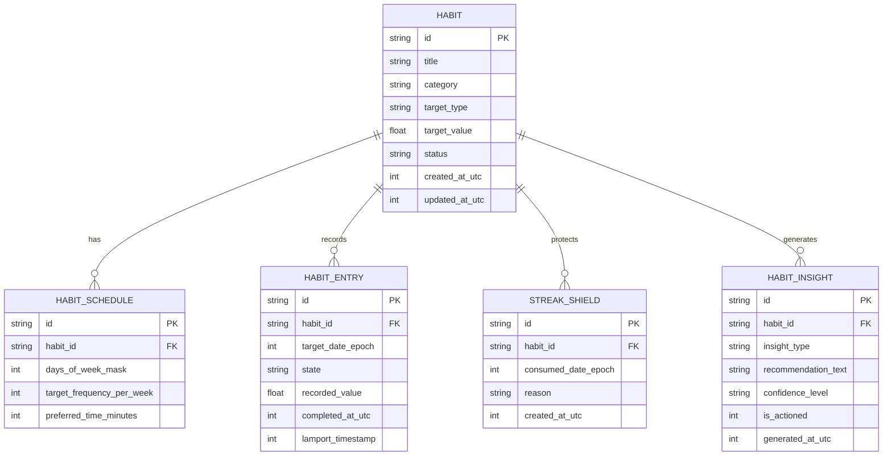
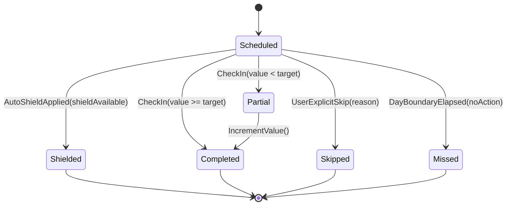
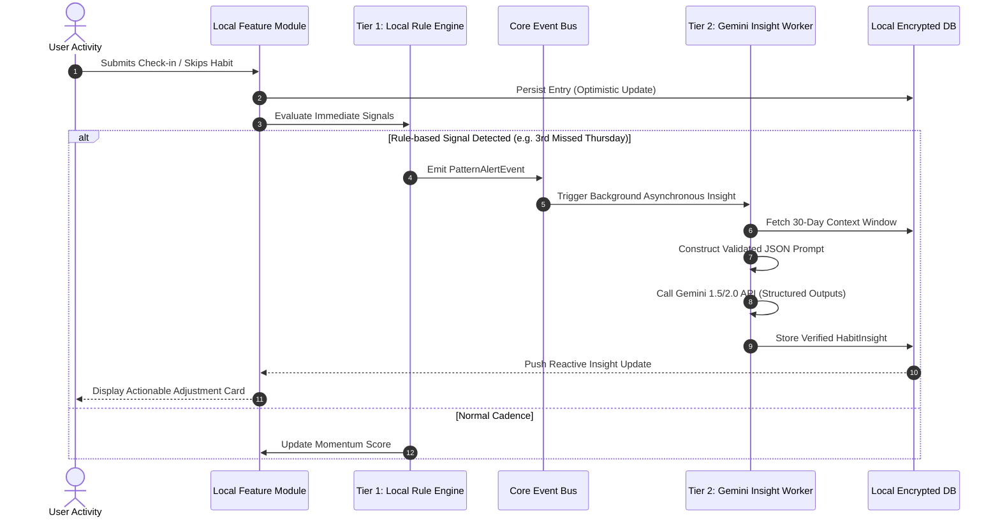

# Product Requirements Document (PRD) & System Design Specification
## Project: 001 - Personalized Habit Tracker with AI Insights
**Author**: Senior Software Development Engineer  
**Status**: Approved & Architecture-Frozen  
**Target Architecture**: Dune Framework for Agents (Vertical Slicing, Strict Import Bans, Zero Comments)

---

## 1. Executive Summary & Problem Framing

### 1.1 Problem Statement
Mainstream habit-tracking applications suffer from an industry-wide **80%+ churn rate within 14 days**. Root causes include:
1. **Binary Streak Fatigue**: The "all-or-nothing" paradigm induces guilt and abandonment upon a single missed day.
2. **Context Blindness**: Static reminder notifications trigger at arbitrary intervals without accounting for user workload, circadian rhythms, or day-of-week exhaustion patterns.
3. **Actionable Insight Void**: Current apps log data passively without answering *why* habits fail or *how* routines should be re-calibrated.

### 1.2 Core Value Proposition
A local-first, low-friction habit tracker engineered with:
* **Resilient Momentum Scoring**: Replaces fragile binary streaks with decay-resistant momentum metrics and automatic "streak shields."
* **Deterministic Heuristic Pre-Filtering**: Zero-latency local pattern detection.
* **Asynchronous AI Insight Engine**: Grounded, contextual recommendations powered by Gemini API that identify root causes of lapses, predict drop-off risks, and dynamically suggest habit micro-adjustments.

---

## 2. Product Requirements Document (PRD)

### 2.1 User Personas
* **The High-Performance Optimizer (Alex)**: Tracks 8+ daily habits. Needs sub-50ms check-ins, offline reliability, and deep statistical correlations (e.g., correlation between sleep duration and morning workout completion).
* **The Consistency Seeker (Jordan)**: Frequently breaks streaks due to irregular work schedules. Needs empathetic recovery mechanisms and anti-burnout nudges rather than punishing resets.
* **The Habit Beginner (Sam)**: Overwhelmed by aggressive targets. Needs intelligent goal sizing (e.g., downscaling "read for 1 hour" to "read for 5 minutes" on high-stress days).

### 2.2 Feature Specifications

#### P0 (Core - Required for V1 Release)
* **Habit Management**: Create, edit, archive, and delete habits with customizable targets (boolean completion, numeric counts, durations) and recurrence schedules (daily, custom weekday masks, $X$ times per week).
* **Instant Check-in & Micro-Logging**: Optimistic UI with sub-second feedback, offline queueing, and swipe-to-complete interactions.
* **Resilience Engine (Momentum & Streak Shields)**:
  * Momentum Score calculated via exponential moving averages ($0\% - 100\%$).
  * Earnable/allocated "Shields" that automatically protect streaks during reported illness, travel, or planned rest.
* **Local Data Sovereignty**: Local-first storage utilizing SQLite/IndexedDB ensuring full offline operability without network dependencies.

#### P1 (High Priority - Differentiating AI Capabilities)
* **Pattern & Lapse Diagnostics**: Identifies recurring failure modes (e.g., "75% of missed meditation sessions occur on Thursdays when work hours exceed 9 hours").
* **Proactive Habit Scaling**: AI suggests temporary target downscaling before streak collapse occurs.
* **Weekly Retrospective Digest**: Automated synthesis of weekly performance highlights, burnout indicators, and specific micro-adjustments for the upcoming cycle.

#### P2 (Fast-Follow Enhancements)
* **Contextual Auto-Triggers**: Location and time geofence integration for just-in-time check-in prompts.
* **Peer Accountability Sync**: End-to-end encrypted habit sharing with trusted accountability partners.

### 2.3 Non-Functional Requirements (NFRs) & Service Level Objectives (SLOs)

| Metric | Target | Verification Method |
| :--- | :--- | :--- |
| **Check-in Mutation Latency** | $< 50\text{ ms}$ (p99) | Local optimistic UI dispatch |
| **Offline-to-Online Sync Latency** | $< 1.5\text{ s}$ for 100 queued events | Benchmarked on simulated 3G network |
| **AI Insight Generation Latency** | $< 2.0\text{ s}$ for streaming summaries | Gemini API structured streaming test |
| **Local Crash-Free Sessions** | $> 99.9\%$ | Automated telemetry crash aggregation |
| **AI Suggestion Relevance / Acceptance** | $> 45\%$ accepted or upvoted | User action telemetry tracking |
| **Client Storage Footprint** | $< 25\text{ MB}$ for 2 years of daily data | Local database compaction tests |

---

## 3. Architecture & System Design (Dune Framework)

The system strictly implements the **Dune Framework for Agents**, segregating core framework primitives from completely isolated, vertically sliced feature modules.



### 3.1 Framework Primitives (`src/core/`)
1. **`core/navigation`**: Type-safe routing table and screen state machine.
2. **`core/storage`**: Local-first embedded relational engine (SQLite over OPFS / IndexedDB wrapper) with schema migration tracking.
3. **`core/ipc`**: In-process pub/sub event bus decoupling domain events (`HabitCompletedEvent`, `StreakShieldTriggeredEvent`) from external side-effects.
4. **`core/sync`**: Conflict-Free Replicated Data Type (CRDT) engine with Lamport timestamps for cross-device state reconciliation.
5. **`core/ai-client`**: Hardened, rate-limited, and retry-resilient transport connecting to the Gemini API with schema validation.

### 3.2 Vertical Feature Modules (`src/features/`)

```
src/
├── core/                                # App Framework Foundation
│   ├── ai-client/
│   ├── database/
│   ├── event-bus/
│   ├── navigation/
│   └── sync/
└── features/
    ├── habits/                          # Feature 1: Habit CRUD & Scheduling
    │   ├── components/
    │   ├── logic/
    │   ├── state/
    │   ├── types/
    │   ├── tests/
    │   └── index.ts                     # Strict Public API Barrier
    ├── streaks/                         # Feature 2: Momentum & Resilience
    │   ├── logic/
    │   ├── state/
    │   ├── types/
    │   ├── tests/
    │   └── index.ts
    ├── insights/                        # Feature 3: AI Inference & Coaching
    │   ├── logic/
    │   ├── prompts/
    │   ├── state/
    │   ├── types/
    │   ├── tests/
    │   └── index.ts
    └── analytics/                       # Feature 4: Visualizations & Metrics
        ├── components/
        ├── logic/
        ├── types/
        ├── tests/
        └── index.ts
```

### 3.3 Dune Boundary Enforcement Rules
1. **Zero Cross-Feature Internal Imports**: `features/insights` cannot import from `features/habits/logic/scheduler`. It can only consume domain events emitted via `core/event-bus` or typed public contracts exposed via `features/habits/index.ts`.
2. **Deterministic Mechanical Failure**: Build tools (`eslint-plugin-import`, TypeScript path boundaries, or dependency-cruiser) fail CI immediately on private module penetration.
3. **Zero Inline Comments in Source**: All implementation files must be written without explanatory or apologetic comments. Clarity is enforced purely through explicit type definitions, domain-driven naming, and small single-responsibility functions.

---

## 4. Domain Data Models & Schema Design

### 4.1 Entity Relationship Diagram



### 4.2 Habit Entry State Transition



### 4.3 Resilience & Momentum Mathematical Formulation
Instead of an integer streak counter that resets to zero upon one lapse, momentum $M_t \in [0, 100]$ is computed using an Exponential Moving Average (EMA) with adaptive penalization:

$$M_t = \alpha \cdot C_t + (1 - \alpha) \cdot M_{t-1}$$

Where:
* $C_t \in \{0.0, 0.5, 1.0\}$ represents completion score on day $t$ (1.0 = Completed, 0.5 = Partial/Shielded, 0.0 = Missed).
* $\alpha \approx 0.15$ (smoothing factor balancing short-term consistency with long-term retention).
* Missed days reduce momentum gradually, eliminating psychological distress while accurately reflecting habitual friction.

---

## 5. AI Ingestion & Inference Architecture

### 5.1 Multi-Tier Insight Engine



### 5.2 Gemini API Structured Schema Contract
To guarantee deterministic client parsing without markdown regex workarounds, all inferences utilize standard JSON Schema mode:

```typescript
export interface HabitInsightResponse {
  readonly habitId: string;
  readonly patternDetected: string;
  readonly rootCauseHypothesis: string;
  readonly severityLevel: "low" | "medium" | "high";
  readonly suggestedAdjustment: {
    readonly adjustmentType: "downscale_target" | "shift_time" | "split_habit" | "pause";
    readonly proposedNewTarget?: number;
    readonly proposedTimeMinutes?: number;
    readonly justification: string;
  };
  readonly encouragementMicroCopy: string;
}
```

### 5.3 Cost Control & Latency Governance
1. **Trigger Throttling**: The AI inference pipeline triggers strictly upon defined heuristic flags (e.g., momentum drops below $60\%$, three consecutive misses, or weekly rollups). Random calls are forbidden.
2. **Context Window Token Budgeting**: 
   * Pre-aggregated compact summaries (e.g., `Mon:1,Tue:1,Wed:0,Thu:0`) replace raw logs, restricting prompt size to $< 500\text{ tokens}$.
3. **Structured Caching**: Identical 7-day behavior signatures return locally cached insights, eliminating redundant LLM API costs.

---

## 6. Edge Cases & Fault Tolerance Strategy

| Failure Scenario | Architectural Protection & Invariant |
| :--- | :--- |
| **Offline Check-in during Travel** | Local SQLite commit is immediate. Lamport timestamp increments. Sync manager flushes delta queue on network restoration via LWW reconciliation. |
| **Cross-Timezone Date Boundary Shifts** | Habit days are pegged to local client timezone dates (`YYYY-MM-DD` string keys) rather than raw UTC timestamps, preventing double check-in anomalies. |
| **Gemini API Outage or Rate Limit (429/503)** | Exponential backoff with jitter up to 3 retries. Complete graceful fallback to Tier 1 local rule engine; user experience is never blocked. |
| **Client Storage Eviction Risk** | Request persistent storage permissions (`navigator.storage.persist()`); fallback automatic export of weekly encrypted recovery snapshots. |

---

## 7. Implementation Roadmap & Vertical Milestones

* **Milestone 1 (Foundation)**: Core framework scaffolding (`core/storage`, `core/event-bus`, `core/navigation`).
* **Milestone 2 (Habit Engine)**: Vertical slice `features/habits` with local CRUD and optimistic check-in UI.
* **Milestone 3 (Resilience)**: Vertical slice `features/streaks` implementing EMA momentum and streak shielding.
* **Milestone 4 (AI Intelligence)**: Vertical slice `features/insights` integrating Gemini structured insight synthesis.
* **Milestone 5 (Analytics & Hardening)**: Vertical slice `features/analytics`, full offline sync stress testing, and mechanical import boundary audits.
* **Milestone 6 (Interactive Frontend)**: React + Vite dashboard (`features/*/components`), `BrowserLocalStoragePort`, interactive micro-logging, EMA resilience visualizations, and comprehensive component tests.
