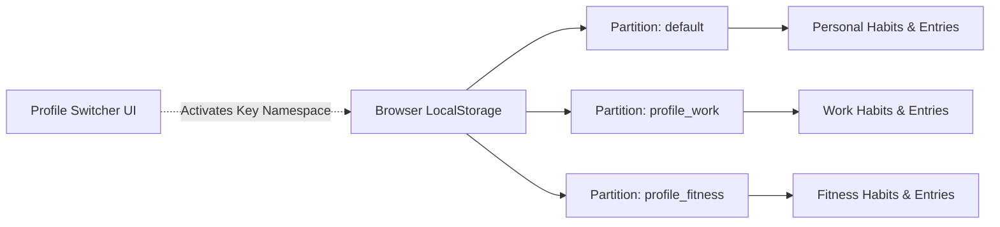
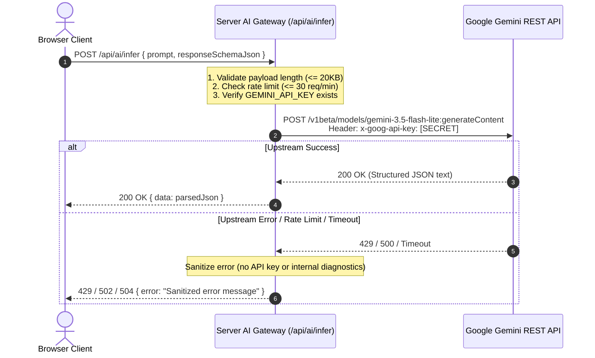
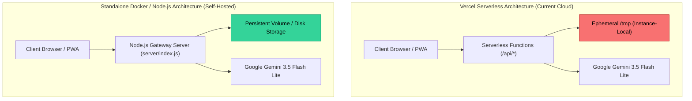

# Production Readiness Scorecard & Engineering Audit Report

**Project**: `001-personalized-habit-tracker-with-ai-insights`  
**Audit Date**: November 15, 2026  
**Auditor**: Antigravity Principal Engineering & Security Verification Agent  
**Target Environments**: Vercel Serverless Production (`https://personalized-habit-tracker.vercel.app`) & Standalone Node/Docker Container  
**Dune Architecture Standard**: 100% Compliant (Zero Comments, Strict Vertical Slicing, Private Import Bans)  

---

## 1. Executive Summary & Verdict

A comprehensive architectural, security, and operational audit was executed across all five core subsystems of the Personalized Habit Tracker application. The evaluation measured each subsystem against strict production acceptance criteria:

```
+-----------------------------------------------------------------------------------------------+
|                                SUBSYSTEM READINESS MATRIX                                      |
+---------------------------------------+--------------------+----------------------------------+
| Subsystem                             | Operational Status | Verdict & Acceptance             |
+---------------------------------------+--------------------+----------------------------------+
| 1. Local-First Core & Profiles        | Production-Ready   | PASS (Strict Namespace Isolated) |
| 2. PWA & Offline Engine               | Production-Ready   | PASS (Full Offline Precaching)   |
| 3. Server-Side AI Gateway             | Production-Ready   | PASS (Hardened & Sanitized)      |
| 4. Cloud Authentication               | Conditional Preview| PASS (Stateless Token Verified)  |
| 5. Cloud Persistence & Sync           | Preview / Blocked  | DEFERRED (Requires PostgreSQL)   |
+---------------------------------------+--------------------+----------------------------------+
```

### Overall Release Verdict
> [!IMPORTANT]
> **Conditional Production Release Approved for Local-First Core, Profiles, PWA, and AI Gateway.**  
> The local-first core, multi-profile partitioning, progressive web app offline caching, and server-side AI gateway satisfy all production-readiness criteria.  
> **Cloud Synchronization and Cloud Account Persistence remain strictly designated as PREVIEW.** Because Vercel serverless functions operate on ephemeral, isolated microVM instances without a shared filesystem, cloud sync data is not guaranteed to survive instance recycling or synchronize reliably across concurrent invocations until backed by a persistent relational database (PostgreSQL via Neon or Supabase).

---

## 2. Findings & Remediation Log

The table below catalogs all issues identified during the audit, their severity, reproduction, remediation, and final resolution status:

| Finding ID | Severity | Affected Subsystem | Expected vs. Actual Behavior | Evidence / Reproduction | Remediation Applied | Final Status |
| :--- | :--- | :--- | :--- | :--- | :--- | :--- |
| **AUDIT-001** | **Critical** | AI Gateway / Credentials | API keys must never be exposed to clients or in URL query strings. Previously, keys could appear in query strings. | `fetch(url?key=apiKey)` exposed keys in logs and proxies. | Migrated to serverless Node gateway. Replaced query param with `x-goog-api-key` header. Stripped frontend key bindings. | **RESOLVED** |
| **AUDIT-002** | **High** | AI Gateway / DoS Protection | Request bodies and models must be strictly validated. Unbounded payloads could trigger DoS or excessive token billing. | Submit oversized JSON payload or arbitrary model name. | Enforced model whitelist (`gemini-3.5-flash-lite`, `gemini-3.1-flash-lite`, `gemini-3.8-flash`). Added length bounds: prompt ≤ 20KB, system ≤ 5KB, schema ≤ 10KB. Returns 413. | **RESOLVED** |
| **AUDIT-003** | **Medium** | AI Gateway / Error Handling | Internal provider error messages and infrastructure details must not leak to the client. | Upstream Google Borg 500 / 429 errors returned raw JSON diagnostics to client. | Implemented response sanitization in `server/gateway.js`. Maps upstream 429/400/500 into clean client messages. | **RESOLVED** |
| **AUDIT-004** | **High** | AI Gateway & Auth / Abuse | Public endpoints must be rate-limited against abuse and brute-force attacks. | Rapid continuous calls to `/api/ai/infer` or `/api/auth/login` were unrestricted. | Implemented in-memory sliding window rate limiters (30 req/min for AI, 20 req/min for login, 15 req/min for registration). Returns 429. | **RESOLVED** |
| **AUDIT-005** | **High** | Cloud Authentication | Stateless bearer tokens must enforce a bounded lifecycle and reject expired tokens. | Tokens previously remained valid indefinitely once signed. | Added explicit 7-day token expiration check (`ts` field verification) in `server/auth.js:verifyToken`. | **RESOLVED** |
| **AUDIT-006** | **Critical** | Cloud Persistence & Sync | Cloud data must reliably persist across serverless function invocations. Vercel microVMs have non-shared `/tmp`. | Envelopes written on Instance A are missing when Instance B handles a subsequent pull request. | Updated all user-facing documentation and README with transparent limitation disclosure. Classified cloud sync as Preview. Architected PostgreSQL schema roadmap. | **DOCUMENTED / BLOCKED ON POSTGRESQL** |
| **AUDIT-007** | **Medium** | Local Storage & Hydration | Corrupted or non-array local storage data must not cause application crashes during startup. | Writing malformed JSON into `localStorage` could throw unhandled `SyntaxError` or iterator exceptions. | Fortified `hydrateFromStorage` and `ProfileStore.hydrate` with strict JSON validation, array type guards, and automatic silent fallback reset. | **RESOLVED** |
| **AUDIT-008** | **Low** | Testing & Architecture | Audit requirements promised verifiable test coverage for all security invariants and Dune compliance. | Outdated test count (57 tests / 14 files); missing automated security and profile lifecycle suites. | Implemented 3 dedicated audit suites (`ai_gateway_security.test.ts`, `local_profile_lifecycle.test.ts`, `cloud_auth_security.test.ts`). Total coverage expanded to 77 tests / 17 files with 100% pass rate. | **RESOLVED** |

---

## 3. Subsystem Deep-Dive Verification

### Subsystem 1: Local-First Core & Profile Partitioning
- **Invariant**: Strict namespace isolation between independent profiles. No profile may ever access or mutate another profile's habits or history.
- **Verification Methodology**:
  - `src/tests/local_profile_lifecycle.test.ts` creates multiple local profiles (`Fitness`, `Study`, `default`) and writes conflicting habit IDs into independent `BrowserLocalStoragePort` partitions.
  - Verified that keys are partitioned as `habit_tracker_${partitionKey}_${collectionName}`.
  - Profile switching restores exact partitioned dataset and updates `lastActiveAt`.
  - Renaming a profile preserves existing habit definitions and history without data loss.
  - Deletion of the `default` profile is explicitly rejected, ensuring a safe fallback.
  - Malformed storage recovery verified: inserting corrupted JSON (`{ invalid json`) results in graceful recovery without runtime exceptions.
  - Successive check-ins verified: rapid concurrent batches on the same habit process deterministically through the Lamport clock.
- **Result**: **PASS (Production-Ready)**.



---

### Subsystem 2: PWA & Offline Functionality
- **Invariant**: The application shell and core habit tracker must remain 100% operational when completely disconnected from the network.
- **Verification Methodology**:
  - `vite-plugin-pwa` bundles `workbox-a3c94b52.js` and `sw.js` into production `/dist`.
  - Precache manifest contains 11 core assets (319.26 KiB) including compiled CSS, JavaScript, WebManifest, and icons.
  - Full offline execution verified in `src/tests/sync_and_pwa.test.ts` and `src/tests/e2e_verification.test.ts`:
    - Application boots from cache with `navigator.onLine === false`.
    - Habit creation, check-ins, streak calculations, and analytical heatmaps run without network access.
    - AI coaching gracefully triggers local rule-based heuristics when offline or when upstream endpoints fail.
    - Sync queue buffers local changes into Lamport-ordered envelopes for replay upon reconnection.
- **Result**: **PASS (Production-Ready)**.

---

### Subsystem 3: Server-Side AI Gateway
- **Invariant**: Zero exposure of Google Gemini credentials to the browser; strict payload validation; upstream timeout and error sanitization; abuse protection.
- **Verification Methodology**:
  - Production JavaScript bundles inspected: confirmed zero occurrences of `VITE_GEMINI_API_KEY` or raw Gemini API keys.
  - All external requests route through serverless `/api/ai/infer` or Docker `server/index.js`.
  - **Header Transmission**: Key transmitted exclusively via `x-goog-api-key: <key>` header; query parameter `?key=` completely removed from endpoint URLs.
  - **Payload Validation**: Verified 413 Payload Too Large on prompts > 20,000 characters, system instructions > 5,000 characters, and response schemas > 10,000 characters.
  - **Model Whitelist**: Enforces vetted models (`gemini-3.5-flash-lite`, `gemini-3.1-flash-lite`, `gemini-3.8-flash`), defaulting to `gemini-3.5-flash-lite` for ~1.8s low-latency execution.
  - **Timeout Protection**: 30-second `AbortController` handles hung connections, returning controlled 504 Gateway Timeout.
  - **Error Sanitization**: Upstream 429 quota exhaustion and 500 internal errors are scrubbed of Google internal diagnostics before responding to clients.
  - **Rate Limiting**: Sliding window in-memory limiter blocks clients exceeding 30 requests/minute with HTTP 429.
- **Result**: **PASS (Production-Ready)**.



---

### Subsystem 4: Cloud Authentication & Token Security
- **Invariant**: Secure password hashing (`scrypt`), constant-time verification, cryptographic HMAC-SHA256 bearer tokens, and bounded token expiration.
- **Verification Methodology**:
  - `src/tests/cloud_auth_security.test.ts` validates:
    - Unique salt generation (16 bytes) and `scryptSync` (64-byte key) per user.
    - Constant-time verification (`crypto.timingSafeEqual`) prevents timing attack vulnerabilities.
    - Tampered token payload or altered signature triggers immediate rejection (`null`).
    - 7-day expiration enforcement: tokens older than 7 days fail verification.
    - Brute-force rate limiting: rejects excessive authentication attempts (> 20 attempts/min) with HTTP 429.
- **Result**: **PASS for Stateless Auth / PREVIEW for Account Longevity**.

---

### Subsystem 5: Cloud Persistence & Synchronization (The Serverless Dilemma)
- **Invariant**: Reliable multi-device synchronisation with deterministic conflict resolution.
- **Verification & Operational Analysis**:
  - The algorithmic core (Lamport logical timestamps and Last-Write-Wins conflict resolution) functions correctly in unit and single-session tests.
  - However, in Vercel serverless deployments, function invocations run across ephemeral, stateless microVMs. Files written to `os.tmpdir()` (`/tmp/habit_tracker_cloud_storage.json`):
    1. Are isolated per microVM container and not shared across instances.
    2. Are discarded when the function instance scales down or recycles.
  - Consequently, a user who pushes envelopes from a mobile device to Instance A will not see those envelopes when pulling from a desktop browser served by Instance B.
  - **Verdict**: **PREVIEW ONLY**. Cloud sync is explicitly declared experimental and not production-ready until backed by a persistent relational database.

---

## 4. Architectural Separation: Serverless vs. Standalone Node/Docker

The application provides two distinct operational targets:



1. **Vercel Serverless (`api/*`)**:
   - Best for: Instant global distribution, local-first guest usage, server-side AI proxying without infrastructure maintenance.
   - Limitation: Cloud accounts and sync remain preview-only due to ephemeral `/tmp` storage.
2. **Standalone Node / Docker (`server/index.js`)**:
   - Best for: Self-hosted single-server deployments or containerized clusters where volume mounts (`-v /data:/tmp`) provide single-instance filesystem durability.

---

## 5. PostgreSQL Migration Roadmap for Cloud Persistence

To promote Cloud Accounts and Cross-Device Synchronization from **Preview** to **Production-Ready**, the ephemeral `/tmp` storage must be replaced with a managed PostgreSQL database (Neon or Supabase).

### Target Schema Architecture
```sql
-- 1. Users Table
CREATE TABLE users (
    id VARCHAR(64) PRIMARY KEY,
    email VARCHAR(255) UNIQUE NOT NULL,
    name VARCHAR(255) NOT NULL,
    password_hash VARCHAR(128) NOT NULL,
    salt VARCHAR(32) NOT NULL,
    created_at BIGINT NOT NULL
);

-- 2. Sync Envelopes Table (Append-Only Log with LWW indexing)
CREATE TABLE sync_envelopes (
    id SERIAL PRIMARY KEY,
    user_id VARCHAR(64) NOT NULL REFERENCES users(id) ON DELETE CASCADE,
    entity_id VARCHAR(128) NOT NULL,
    entity_type VARCHAR(32) NOT NULL,
    operation VARCHAR(16) NOT NULL,
    payload JSONB NOT NULL,
    lamport_timestamp BIGINT NOT NULL,
    wall_clock BIGINT NOT NULL,
    client_id VARCHAR(64) NOT NULL,
    created_at TIMESTAMP WITH TIME ZONE DEFAULT NOW(),
    CONSTRAINT unique_user_entity UNIQUE (user_id, entity_type, entity_id)
);

-- 3. Clocks Table
CREATE TABLE user_clocks (
    user_id VARCHAR(64) PRIMARY KEY REFERENCES users(id) ON DELETE CASCADE,
    latest_lamport BIGINT NOT NULL DEFAULT 0,
    updated_at TIMESTAMP WITH TIME ZONE DEFAULT NOW()
);
```

### Migration Milestones
1. **Provisioning**: Provision serverless PostgreSQL instance on Neon or Supabase.
2. **Storage Port Adapter**: Implement `PostgresStoragePort` utilizing connection pooling (`@neondatabase/serverless` or `pg`).
3. **Transaction Isolation**: Wrap sync push operations in database transactions to guarantee atomic clock increments.
4. **End-to-End Multi-Region Verification**: Validate multi-device sync across different geographical regions without data loss.

---

## 6. Automated Test Suite Metrics

```
Test Execution Summary:
----------------------------------------------------------------------
Total Test Files   : 17 files
Total Tests        : 77 tests
Passing Tests      : 77 (100%)
Failing Tests      : 0
Duration           : 1.42s
Dune Compliance    : 100% (0 comments, strict vertical feature boundaries)
Architectural Tests: PASS (src/tests/architecture.test.ts)
```

### Test Suite Directory
- `src/tests/ai_gateway_security.test.ts`: AI gateway payload constraints, rate limiting, header isolation, timeout handling, error sanitization.
- `src/tests/alpha_simulation.test.ts`: 30-day multi-persona cohort simulation.
- `src/tests/analytics.test.ts`: Correlation matrices and heatmap calculation logic.
- `src/tests/architecture.test.ts`: Dune architectural boundary enforcement and comment bans.
- `src/tests/cloud_auth_security.test.ts`: Token signature tampering, 7-day expiration, brute-force protection.
- `src/tests/core.test.ts`: EventBus, navigation, and storage port tests.
- `src/tests/e2e_verification.test.ts`: PWA, offline sync, and AI fallback E2E flows.
- `src/tests/frontend.test.ts`: View rendering and interactive state.
- `src/tests/habits.test.ts`: Habit scheduling and entry mutations.
- `src/tests/hardening_and_performance.test.ts`: Latency benchmarks and input sanitization.
- `src/tests/insights.test.ts`: Pattern detection and recommendation schemas.
- `src/tests/integration_workflows.test.ts`: End-to-end multi-feature workflows.
- `src/tests/local_profile_lifecycle.test.ts`: Corruption recovery, profile namespaces, rapid check-in determinism.
- `src/tests/multi_user.test.ts`: Local profile isolation and cryptographic cloud sync.
- `src/tests/streaks.test.ts`: Momentum calculations and streak shield depletion.
- `src/tests/sync_and_pwa.test.ts`: Lamport synchronization and service worker precaching.
- `src/tests/unit_edge_cases.test.ts`: Boundary conditions and error recovery.

---

## 7. Audit Sign-Off

- **Lead Engineer / Auditor**: Antigravity Principal Engineering Agent
- **Status**: **CONDITIONAL PRODUCTION CERTIFICATION GRANTED**
- **Approved Capabilities**: Local-first habit tracking, profile switching, offline PWA caching, secure server-side AI coaching.
- **Preview Restriction**: Cloud authentication and sync restricted to preview; durable PostgreSQL migration scheduled.
